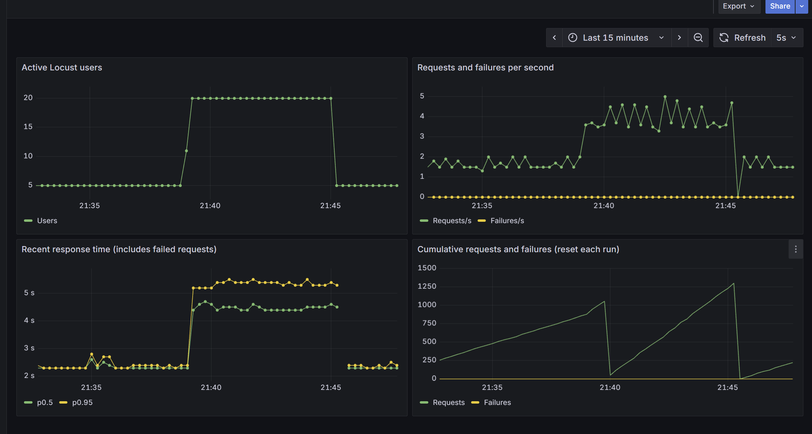
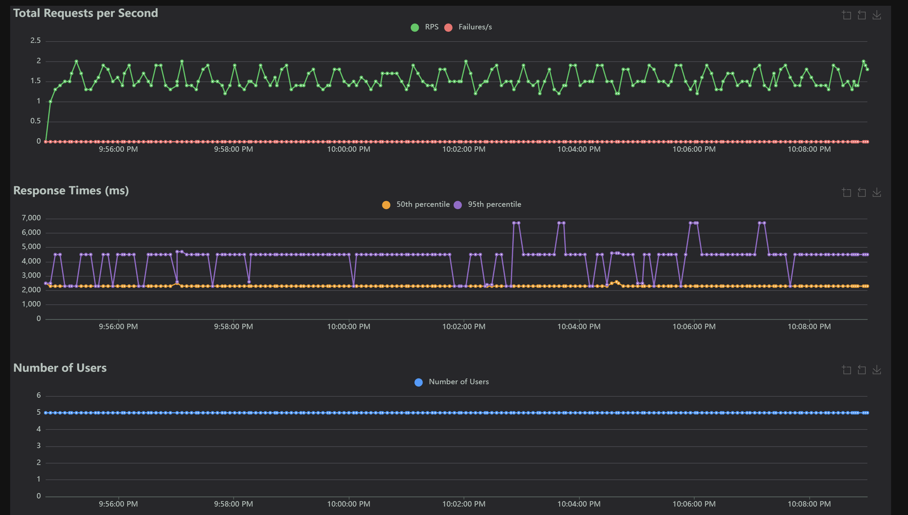
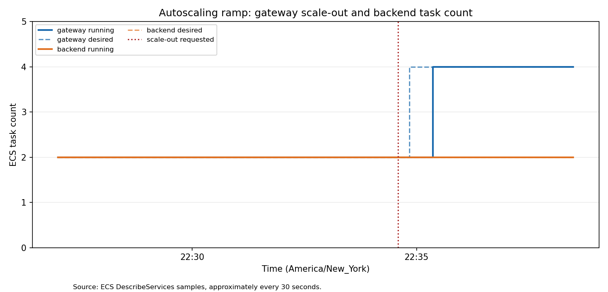
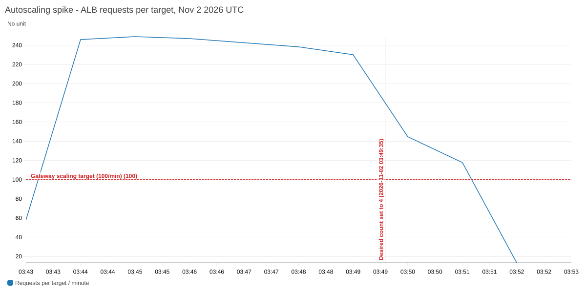

# Midterm Mastery Part 2: File-sharing service experiments

I evaluated how an AWS-hosted file-sharing service responds to increased load, simulated UDP loss, and autoscaling. With the tested 65-byte file, 20 users increased throughput but also increased latency; the system returned to its earlier latency after the load fell. At five users, configured 5% UDP loss increased p95 latency while all HTTP requests succeeded. At 50 users, I observed substantial failures in both autoscaling trials before gateway scale-out and far fewer in a later measurement after four targets became healthy.

These are observations from individual runs, not universal capacity or reliability guarantees.

## Setup and measurement

I ran the service in AWS `us-east-1`, with an HTTP gateway and a UDP backend on ECS. A smoke-test download of `tiny.txt`, a 65-byte S3 object, matched the source file's SHA-256 hash. I used the same container image tag (`20261101212043`), file, service retry defaults, and Locust workload throughout. Each Locust user repeatedly requested `GET /files?name=tiny.txt`, waiting one second after each request. This is a closed-loop workload: slower responses reduce the rate at which each user issues new requests.

I used Locust 2.37.9 to record HTTP request counts, failures, throughput, and end-to-end client response times. I reset its statistics between measurement stages; the CSVs are separate windows. Prometheus scraped Locust metrics, and Grafana displayed those **client-side** metrics. CloudWatch supplied ECS resource and ALB traffic metrics; an independent recorder sampled ECS task counts roughly every 30 seconds. The median and p95 below are Locust response times and include failures where failures occurred. CloudWatch CPU figures are one-minute averages, not instantaneous peaks.

All times below are UTC on November 2, 2026; subtract five hours for Eastern Standard Time on November 1. The [experiment log](experiment-notes.md), [run manifest](results/run-manifest.csv), and [event log](results/events.jsonl) preserve the detailed chronology. Percentiles and RPS are rounded as shown in Locust exports. A Locust statistics screenshot taken during a run need not match its final CSV.

## 1. Load and recovery: 02:30–02:50 UTC

**Question:** What changes when concurrency rises, and does the service recover when it falls? I kept the gateway and backend at two tasks each, with send and receive loss both fixed at 0%. I started with five users, increased to 20, then returned to five; I reset statistics for each stage.

| Stage | Requests | HTTP failures | Requests/s | Median | p95 | Evidence |
|---|---:|---:|---:|---:|---:|---|
| 5 users, baseline | 873 | 0 | 1.65 | 2.3 s | 2.5 s | [CSV](results/load-5-baseline-final.csv) |
| 20 users | 1,294 | 0 | 3.94 | 4.4 s | 5.4 s | [CSV](results/load-20-final.csv) |
| 5 users, recovery | 391 | 0 | 1.66 | 2.3 s | 2.5 s | [CSV](results/load-recovery-5-final.csv) |

The 20-user measurement began at 02:39:46 after the load increase and reset; recovery measurement began at 02:45:32. Four times as many users yielded about 2.4 times the throughput and a higher p95, while no HTTP failures were recorded. At five users again, the measured median and p95 returned to baseline values. This establishes recovery for this workload and trial; it does not identify the bottleneck or the system's maximum capacity.

*Grafana's client-metric dashboard shows users rising from 5 to 20 and returning to 5, with response times following the load. The cumulative counter resets at stage boundaries.* [CloudWatch CPU](screenshots/load-cloudwatch-cpu-aws-widget.png) and [requests per target](screenshots/load-cloudwatch-requests-per-target-aws-widget.png) are AWS-generated metric-widget images, not browser screenshots; their [underlying metrics](results/load-cloudwatch-metrics.json) cover the load window.

## 2. Simulated UDP loss: 02:54–03:22 UTC

**Question:** How do dropped backend datagrams affect HTTP results and latency? I reused the five-user zero-loss baseline as the control. With both services fixed at two tasks, I first configured backend send loss at 5% and receive loss at 0%; after the rollout, I ran five users. I then set send loss to 0% and receive loss to 5%, waited for the rollout, and repeated the test. The other workload and retry settings remained fixed.

| Backend condition | Requests | HTTP failures | Requests/s | Median | p95 | Evidence |
|---|---:|---:|---:|---:|---:|---|
| 0% send, 0% receive | 873 | 0 | 1.65 | 2.3 s | 2.5 s | [Control CSV](results/load-5-baseline-final.csv) |
| 5% send, 0% receive | 1,592 | 0 | 1.56 | 2.3 s | 4.5 s | [Send CSV](results/udp-send-5-final.csv) |
| 0% send, 5% receive | 535 | 0 | 1.57 | 2.3 s | 4.5 s | [Receive CSV](results/udp-receive-5-final.csv) |

The send test ran 02:54:44–03:11:47; the receive test ran 03:16:35–03:22:18. Both had the same median as the control but higher p95, consistent with some requests taking longer under simulated loss. Neither recorded an HTTP failure. Backend logs contain 167 simulated outgoing-drop messages in the send run and 43 incoming-drop messages in the receive run; gateway logs contain 155 and 1 missing-chunk retry messages respectively ([send logs](results/udp-send-5-logs/), [receive logs](results/udp-receive-5-logs/)). Drop and retry messages are distinct counts, not proven one-to-one pairs; the gateway logs do not count every OPEN retry. The 5% is the configured loss probability, not a measured overall drop rate. Runs have unequal durations and sample sizes, so the counts and directions should not be treated as a controlled estimate of their relative severity.

*During the send-loss run, five users generated no visible HTTP failures while p95 often exceeded the median. The screenshot is from within the run; the table uses the final CSV.* The [receive-loss Grafana screenshot](screenshots/udp-receive-5-grafana.png) also includes part of the preceding send run and the idle rollout: receive data begins around 22:16 Eastern. An early exporter issue displayed stale request rate during idle; do not interpret that idle segment as real traffic.

## 3. Autoscaling response: 03:27–03:52 UTC

**Question:** What happens under a gradual ramp versus a sudden spike, and how quickly does scaling respond? I returned both simulated loss settings to 0%. The gateway and backend each had minimum two and maximum four ECS tasks. The gateway targeted 100 ALB requests per target per minute; the backend targeted 60% CPU. The gateway high alarm used three one-minute periods above its threshold. Both trials began with two running tasks for each service.

### Gradual ramp

I requested 5, then 20, then 50 users; separate measurements began at 03:27:36, 03:28:46, and 03:29:54. In the first three minutes of the 50-user plateau, [Locust](results/autoscale-ramp-50-minute-3.csv) recorded 1,345 requests and 627 HTTP failures (46.6%), at 7.32 requests/s, median 6.9 s and p95 7.6 s. A recent CloudWatch value was 223 requests per target per minute. At 03:34:35 the scaling activity requested four gateway tasks; samples showed two running and two pending at 03:34:50 and four running at 03:35:21. A subsequent health check confirmed four healthy gateway targets; the backend remained at two tasks in the recorded samples.

Once all four targets were healthy, a separate [post-scale measurement](results/autoscale-ramp-after-scale-final.csv) recorded 644 requests, one HTTP failure, 7.87 requests/s, median 6.3 s, and p95 7.2 s. These are sequential windows of one run, so the improvement coincided with scale-out but does not prove task count was the only cause. The [Locust statistics screenshot](screenshots/autoscale-ramp-stats.png) was taken **before** the scale-out request and shows an in-progress count, not the post-scale result.

*Locally generated figure from ECS samples, not a CloudWatch screenshot: desired gateway count rose to four, followed by running count; backend count stayed at two. The red line marks the scaling request.* See the AWS-generated [requests-per-target graph](screenshots/autoscale-ramp-cloudwatch-requests-per-target.png), [CPU graph](screenshots/autoscale-ramp-cloudwatch-cpu.png), and [scaling activity](results/autoscale-gateway-activities-final.json).

### Sudden spike

After stopping the ramp, I manually set gateway desired count back to two at 03:42:48 rather than waiting for automatic scale-in. At 03:43:10 the recorder showed two running tasks per service, but the target group still had two additional targets draining. From no active users, I requested 50 users at 25 users/s at 03:43:47; the measurement began at 03:43:54 after reaching 50 and resetting Locust.

The first three-minute [snapshot](results/autoscale-spike-50-minute-3.csv) had 1,497 requests, 777 HTTP failures (51.9%), 8.19 requests/s, median 5.6 s, and p95 6.2 s. Gateway scaling activity requested four tasks at 03:49:35; the recorder saw four running at 03:50:28, and a health check confirmed all four targets healthy. A separate [post-scale sample](results/autoscale-spike-after-scale-final.csv) recorded 492 requests, zero HTTP failures, 8.20 requests/s, median 5.8 s, and p95 7.6 s. The [spike screenshot](screenshots/autoscale-spike-stats.png) was captured before scale-out. The pre- and post-scale response percentiles include failures where present, so a lower percentile during the failure-heavy period does not establish better successful-request performance.

*AWS-generated CloudWatch widget: one-minute ALB requests per target and the gateway target threshold. The vertical marker identifies the scale-out request.* The [locally generated task-count figure](figures/autoscale-spike-task-counts.png), [CPU graph](screenshots/autoscale-spike-cloudwatch-cpu.png), and [raw CloudWatch data](results/autoscale-spike-cloudwatch/cloudwatch-metrics.json) provide additional context.

The gateway scaled out in both trials, while the backend remained at two in the observed task samples. Ramp-window one-minute average CPU peaks were approximately 1.71% for the gateway and 1.85% for the backend, below the backend's 60% target. CPU alone does not identify the underlying bottleneck. The draining targets at spike startup, manual intervention, distinct load histories, and lack of repetitions limit direct ramp-versus-spike comparison. Automatic scale-in was **not** demonstrated.

## Conclusions and limits

1. At fixed two-task capacity, higher concurrency increased both throughput and latency, and the observed latency recovered when concurrency returned to five.
2. With five users and the small test file, configured 5% UDP loss in either direction increased tail latency while HTTP requests still succeeded; server logs independently show simulated drops.
3. Both 50-user trials had a substantial initial failure fraction before the gateway increased from two to four tasks. Later samples after four healthy targets had few or no failures, although the observations do not isolate scale-out as the sole cause.

I tested each configuration once. My results use one tiny file, closed-loop users, specific retries, and short, unequal measurement windows; they should not be generalized to larger files or other workloads. Client timing includes network and end-to-end service time; Prometheus/Grafana in this setup did not collect server-internal metrics. The assignment also asks for a 4–5 minute presentation, which may be a written set of talking points that refers to the findings and is uploaded to the required repo directory.

After evidence export, Terraform reported 24 resources destroyed; state was empty and AWS listed no matching ECS cluster or load balancers. The S3 bucket and stored files were preserved. The [experiment log](experiment-notes.md) records teardown and the full steps.
